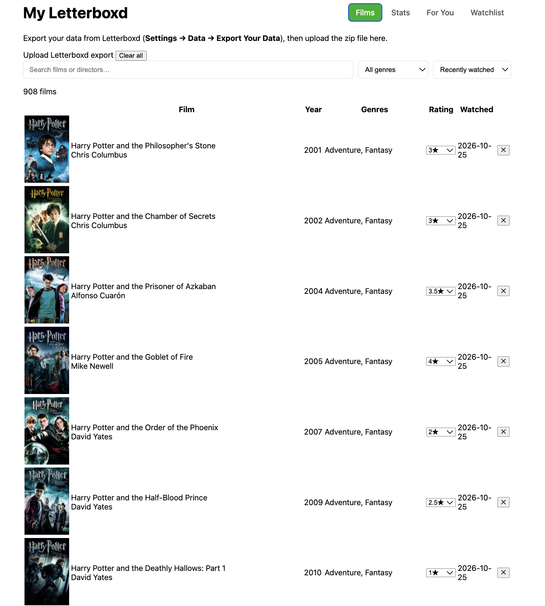
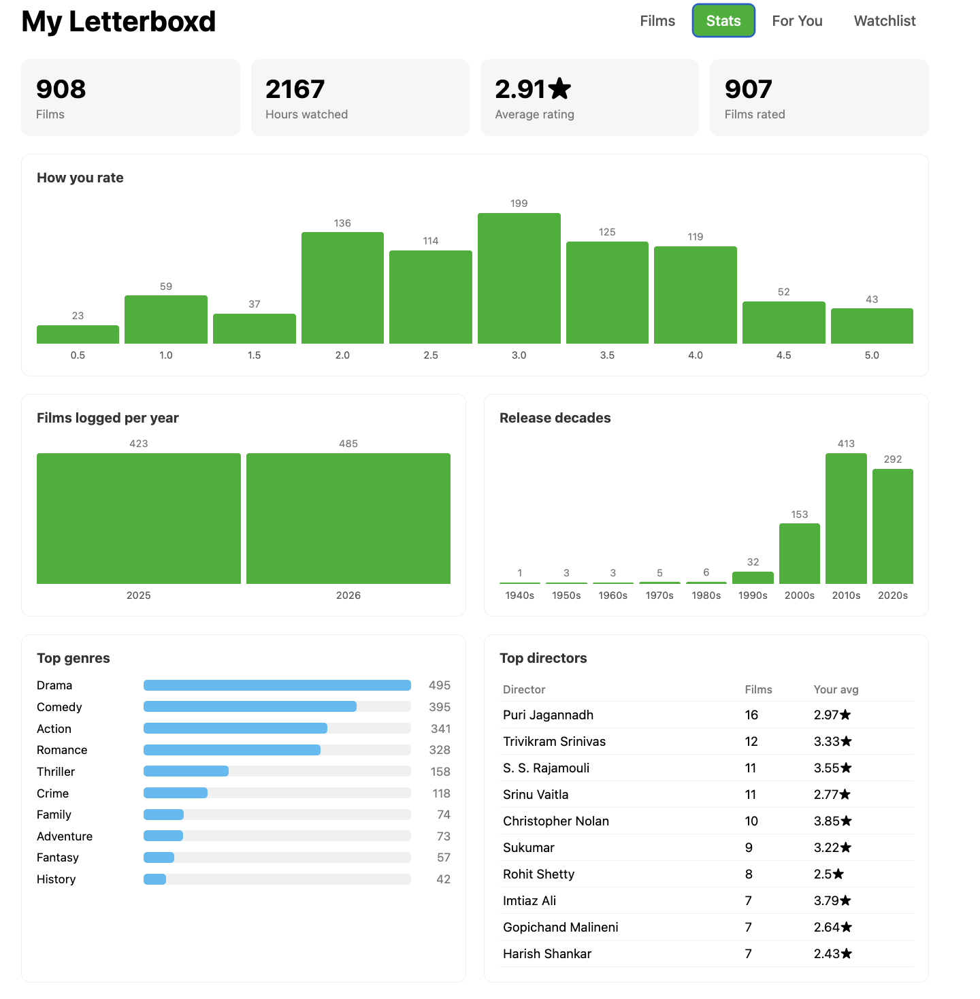
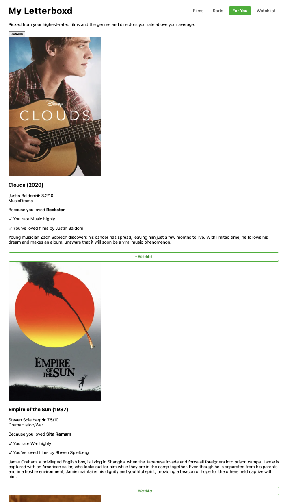
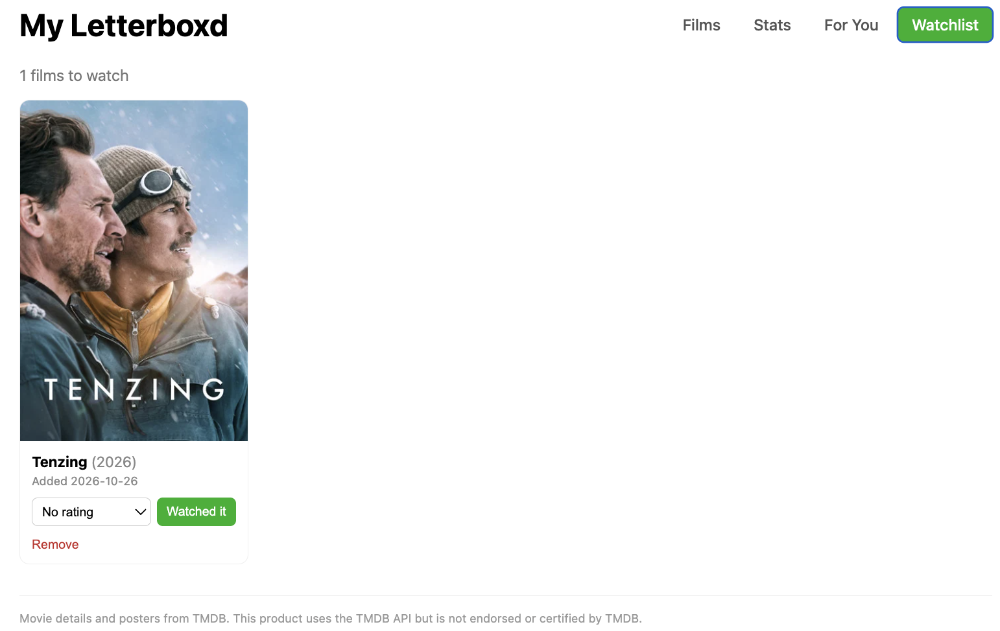

# Letterboxd Insights

A full stack web app that turns a Letterboxd export into a personal film dashboard: your full watch history with posters and details, stats about your taste, and recommendations explained in plain language.

**Stack:** Java 21 · Spring Boot · Spring Data JPA · MySQL · Angular · TypeScript · TMDB API



## Features

- **Import:** upload the Letterboxd export zip (or individual CSVs). Re-uploads update existing films instead of duplicating them.
- **Enrichment:** each film is matched on TMDB to add posters, genres, director, runtime, and audience rating, processed in batches with a live progress bar.
- **Film library:** search by title or director, filter by genre, sort by rating, release year, or watch date. Edit ratings inline or delete films.
- **Stats dashboard:** hours watched, rating distribution, films per year, release decades, top genres and directors, and "hot takes" where your rating differs most from the audience.
- **Recommendations:** personalized picks with reasons, such as "Because you loved *RRR*" or "You rate War highly".
- **Watchlist:** save recommendations, then mark them watched with a rating to move them into your library.

| Stats | For You | Watchlist |
|---|---|---|
|  |  |  |

## How the recommendations work

A content-based recommender with a light collaborative signal:

1. **Taste profile:** for every genre and director, measure how far above or below your own average rating you score their films. Small samples are shrunk toward zero, so one film doesn't make you a "fan".
2. **Candidates:** take your 20 highest-rated films and collect TMDB's similar-film suggestions for each, excluding anything already watched or on your watchlist.
3. **Scoring:** reward films suggested by several favorites, films in genres and by directors you rate highly, and films audiences rate well; penalize very obscure titles.
4. **Diversity:** a single favorite can drive at most two picks, so one film doesn't dominate the list.
5. **Explanations:** every pick lists the favorites and taste matches behind it.

## Architecture

```
Angular (localhost:4200)
   │  REST / JSON
   ▼
Spring Boot (localhost:8080)
   ├── Controllers  →  Services  →  Repositories (Spring Data JPA)
   │                                      │
   │                                      ▼
   │                                    MySQL
   └── TmdbClient (RestClient)  →  TMDB API
```

## API

| Method | Endpoint | Description |
|---|---|---|
| GET | `/api/films` | All films |
| POST | `/api/films/upload` | Import a Letterboxd zip or CSV |
| POST | `/api/films/enrich` | Fetch TMDB details for the next batch of films |
| PATCH | `/api/films/{id}` | Update a film's rating |
| DELETE | `/api/films/{id}` | Delete a film |
| DELETE | `/api/films` | Delete all films |
| GET | `/api/stats` | Dashboard statistics |
| GET | `/api/recommendations` | Personalized recommendations |
| GET | `/api/watchlist` | Watchlist |
| POST | `/api/watchlist` | Add a film to the watchlist |
| DELETE | `/api/watchlist/{id}` | Remove from watchlist |
| POST | `/api/watchlist/{id}/watched` | Mark watched with a rating; moves it to films |

## Running it locally

**Prerequisites:** Java 21, Node.js (LTS), Angular CLI, MySQL, and a free [TMDB API](https://developer.themoviedb.org/) read access token.

**1. Database**

```sql
CREATE DATABASE letterboxd;
CREATE USER 'letterboxd_user'@'%' IDENTIFIED BY 'choose_a_password';
GRANT ALL PRIVILEGES ON letterboxd.* TO 'letterboxd_user'@'%';
```

**2. Secrets.** Create `secrets.properties` in the backend root (it's git-ignored):

```properties
spring.datasource.password=choose_a_password
tmdb.token=your_tmdb_read_access_token
```

**3. Backend**

```
./mvnw spring-boot:run
```

**4. Frontend** (in the `letterboxd-ui` project)

```
npm install
ng serve
```

Open http://localhost:4200, upload your Letterboxd export (Settings → Data → Export Your Data), then click **Load movie details**.

## Design decisions

- **Single-user by design.** The app stores no emails, passwords, or other personal data.
- **Secrets stay out of Git.** Database password and API token live in a git-ignored `secrets.properties`.
- **Batch enrichment.** TMDB lookups run in batches of 20 so the UI can show progress and a refresh never loses work.
- **Idempotent imports.** Films are matched by their Letterboxd URI, so re-importing updates rather than duplicates.

## Ideas for the future

- Collaborative filtering trained on the MovieLens dataset, as a separate Python service
- Importing the Letterboxd watchlist and diary
- Docker Compose setup for one-command startup

---

Movie data and posters from [TMDB](https://www.themoviedb.org/). This product uses the TMDB API but is not endorsed or certified by TMDB.
